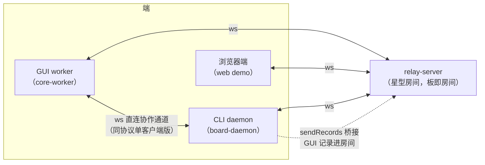
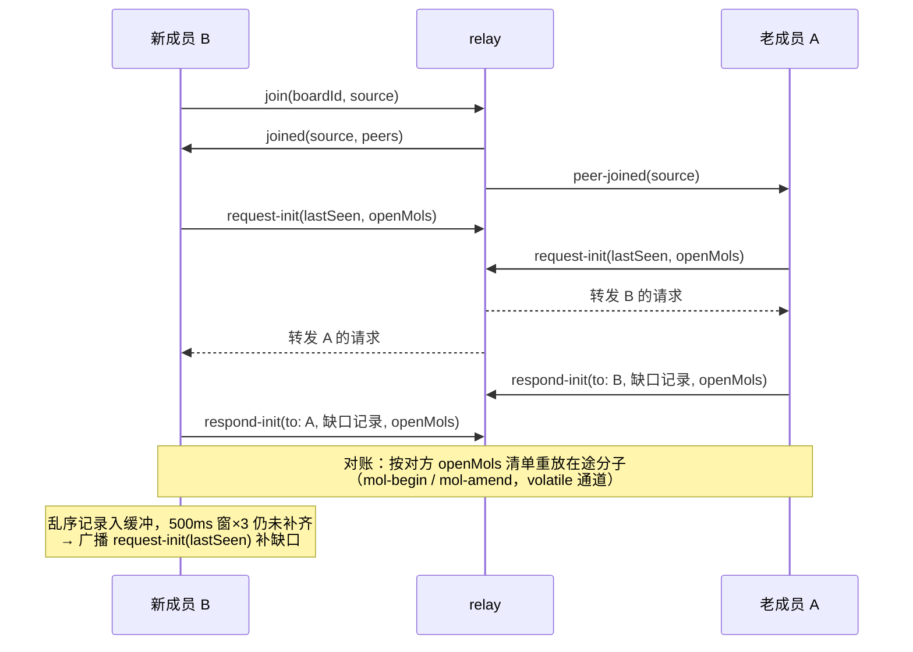

# 同步层文档

本文档提供协作同步层（`src/host/sync/`）的概述与实现语义：多端经中继服务器交换操作记录与 AOM 活动事件，各端收敛到同一板状态。内核侧的收敛规则见[时间回溯树内核文档](../../../kernel/hit/docs/undo-tree-kernel-document.md)，会话持久化见[会话存储内核文档](../../../kernel/store/docs/store-document.md)。

> [!NOTE]
>
> **实现状态**：中继服务器（无状态纯转发、板即房间）、网络协调器（本地广播、远程接入、延迟容忍窗、增量 INIT 补齐、周期摘要校验、断线清理、连接超时与自动重连、lastSeen 增量握手、在途分子对账、AOM 活动状态重广播）、GUI 接入（core-worker 携带 syncUrl 自动连接）、CLI daemon 化、awareness 通道与分子中间帧预览（amend 通道）均已落地并通过跨设备（Windows + macOS）双 Tauri 窗口实测。

## 模块定位

同步层是内核的传输宿主：kernel 保持零网络依赖，`applyRemoteOperations` 是唯一远端接入缝。中继与协调器全部在 `src/host/sync/`：

- `network-coordinator.js`：BoardApi 的同步薄包装，订阅日志与活动事件、维护连接与 INIT/digest
- `remote-record-ingestor.js`：relay 与 daemon 共用的记录去重、依赖预检、pending 与权威水位接入器
- `remote-activity-channels.js`：按 BoardCore、来源与通道登记远程活动引用，控制断线清理
- `relay-server.js`：无状态中继，房间成员管理、消息护栏与房间内广播
- `start-relay.js`：启动入口（`yarn relay`，默认仅绑 127.0.0.1；`--host 0.0.0.0` 时打印局域网地址）

数据流：端（GUI worker / CLI / 测试对等端）经 WebSocket（JSON 消息）连接中继，本地操作由协调器广播，远程消息经协调器接入内核。

## 拓扑与房间

星型拓扑：各端连接同一中继，消息经中继转发，端与端不直连。**板即房间**：join 时携带 boardId，中继按 boardId 分组，不同房间互不可见。demo 固定房间 `demo-board`，无认证（信任本机/局域网）。

同一房间内以 source 标识成员；**同 source 重复加入踢旧迎新**（旧连接被 terminate，新连接正常 joined；顶替不广播 peer-left，成员关系由 peer-joined 覆盖）。合法重连借此快速顶替半开死连接；同机多窗口共享 localStorage 时身份可能冲突，demo 提供 `hwb.setSource` 显式区分。

### GUI 直连 daemon 拓扑

除 relay 星型房间外，GUI worker 还会直连持板 daemon 的协作通道（`core-worker` 的 `#connectGuiDaemon`）：

- **探测与重连**：每次尝试先重新探测 daemon（重启后端口可能变化，经 `.daemon.json` 描述文件发现）；失败起每 3s 重试（`#scheduleGuiReconnect`）。
- **boardId = rootPath**：直连协调器以板根路径作 boardId，与 relay 房间协议同构（join/records/aom/awareness/digest 的单客户端版）。
- **桥接进房间**：daemon 侧把 GUI 写入的记录经 `sendRecords` 桥进 relay 房间（`board-daemon.js` 的 records 分支），GUI 的操作对远端可见；daemon 连了中继才桥接。
- **单机降级**：无 daemon（或 daemon 不可达）时 GUI 按单机自治运行，写权仲裁落盘兜底（见会话存储文档），协作通道断开仅按 3s 重试，不阻塞开板。
- 断线重连后的全量收敛沿用同步机制的 digest / request-init 对账。

## 消息协议（JSON over WebSocket）

| 方向            | 消息                                                          | 语义                                                |
| --------------- | ------------------------------------------------------------- | --------------------------------------------------- |
| 客户端 → 服务器 | `{type:"join", boardId, source}`                              | 加入房间（首条消息必须为 join）                     |
| 服务器 → 客户端 | `{type:"joined", source, peers:[...]}`                        | 加入确认 + 现有成员列表                             |
| 服务器 → 客户端 | `{type:"peer-joined", source}` / `{type:"peer-left", source}` | 成员变动广播                                        |
| 客户端 → 服务器 | `{type:"records", records:[...]}`                             | 操作记录广播（微任务合批）                          |
| 服务器 → 客户端 | `{type:"records", source, records:[...]}`                     | 记录转发（附来源，不回发发送者）                    |
| 客户端 → 服务器 | `{type:"aom", event:{kind, ids, choice?, ...}}`               | AOM 活动事件广播（choose 携带命名选择名）           |
| 服务器 → 客户端 | `{type:"aom", source, event}`                                 | 活动事件转发                                        |
| 客户端 → 服务器 | `{type:"awareness", data}`                                    | awareness 广播（volatile）                          |
| 服务器 → 客户端 | `{type:"awareness", source, data}`                            | awareness 转发（可丢、不进日志）                    |
| 客户端 → 服务器 | `{type:"request-init", lastSeen?, openMols?}`                 | 请求增量日志（无 lastSeen 为全量；openMols 供对账） |
| 服务器 → 客户端 | `{type:"request-init", source, lastSeen?, openMols?}`         | 增量请求转发                                        |
| 客户端 → 服务器 | `{type:"respond-init", to, records, openMols?}`                 | 定向缺口响应（无 lastSeen 请求时为全量）            |
| 服务器 → 客户端 | `{type:"respond-init", source, records, openMols?}`             | 定向转发（仅目标收到）                              |
| 客户端 → 服务器 | `{type:"digest", digest}`                                     | 周期状态摘要（默认 30s）                            |
| 服务器 → 客户端 | `{type:"digest", source, digest}`                             | 摘要转发                                            |

## 中继服务器

- **无状态纯转发**：不缓存任何记录，离线与迟到合并由各端重连对账负责；房间成员表是唯一状态。
- **广播语义**：records/aom/awareness/digest 广播给房间内除发送者外全部成员；request-init 同广播；respond-init 定向。awareness 是 volatile 通道：不经 operationLog / applyRemoteOperations，无持久化、无确认重发、不参与哈希校验。
- **心跳踢幽灵**：按 heartbeatMs（默认 30s）周期 ping 全部连接，一轮未回 pong 的连接被 terminate（走与 close 相同的移出路径，广播 peer-left）；进程被杀、网络分区、合盖等半开死连接借此及时清出房间，不再占成员表与广播面。ws 客户端与浏览器/undici WebSocket 均按协议自动回 pong，正常端无感。
- **连接生命周期**：close/error 移出房间并广播 peer-left；房间空则销毁。
- **默认本地绑定**：`createRelayServer` 默认绑 127.0.0.1（仅本机），显式传 host 才绑其他接口；`yarn relay` 默认仅本机，`--host 0.0.0.0` 才绑全部接口并打印局域网地址（零鉴权，仅在可信网络开启）。
- **输入与背压护栏**：入站消息默认上限 16 MiB（`maxPayload`）；单连接已排队发送字节默认上限 4 MiB（`maxBufferedAmount`），超限连接被 terminate，由客户端重连对账；同一连接的 request-init 默认最小间隔 1s（`requestInitMinIntervalMs`）。send/ping 失败走统一连接清理。
- **非法消息**：join 前非 join 消息、格式非法消息一律忽略。

## 网络协调器

### 本地 → 远端

- 订阅 `operationLog.onAppend`：仅广播本端 source 的记录（远程应用的记录过滤，防回环放大）。
- **微任务合批**：同一同步行程内连续产生的记录合为一批发出（如 endSupra 强制闭合在途分子并追加 close-supra 的同步连发），接收端同批接入；成员记录本就独立有效，合批只为同批美观（接入侧按 supraId 成组同批应用，见下）。
- 订阅 `activityEventBus`：手势内 choose/commit 事件即时广播（choose 记录即时入日志挂 supraId、随记录通道收敛；此通道提供手势内的即时互斥与实时可见性，不等记录通道）。choose 事件携带 `choice`（命名选择名，匿名缺省）；unchoose/commit 事件按（来源，对象）注销，无需携带。
- **awareness 通道**：光标位置经 `sendAwareness` 走 volatile 通道广播，接收端由 `onAwareness` 回调转发宿主（只画不存）；peer-left 以 `{kind:"peer-left"}` 通知，供接收端清理远程光标。远程选择的装饰走 aom 可靠通道与 remote-activity 通知，不经 volatile 通道。
- **分子中间帧预览**：分子写入口在内核事件总线发射 amend 事件（begin-mol / amend / end-mol / abort-mol），`amend-forwarder` 负责转发：begin-mol 即时发出（不合批）；amend 按 33ms 间隔节流合批（position/transform/data 绝对值后帧盖前帧、append items 按序累积、seq 取批内最大）打包为 mol-amend 发出；end-mol 先冲出残余缓冲再即时发 mol-end，abort-mol 丢弃该分子缓冲后即时发 mol-abort。均经 volatile 通道广播；接收端只画不存，丢了不补，分子记录经可靠通道到达后按记录定格归位。本端断线时协调器经 `onDisconnect` 通知 UI 清空全部预览与光标（对端手势状态不可信），重连后各自重建。

### 远端 → 本地

- **统一接入**：`remote-record-ingestor` 由 relay 协调器与 daemon 直连通道共用，负责记录去重、结构预检、pending 缓冲与分组排空；`applyRemoteOperations` 对已有记录幂等，同 ID 内容冲突显式拒绝，整批校验在写入前完成。
- **权威水位**：每轮 drain 从 operationLog 重算各 source 的连续前缀，其他通道或本地提交推进日志后经微任务唤醒 pending；多协调器共享 BoardCore 时不持有会过期的私有序号水位。
- **依赖预检**：除来源序号与 parentId 外，undo/move-head 的 targetNodeId、redo 的 targetUndoId 也必须先到；合法缺依赖记录继续等待，确定非法记录隔离并告警，不触发周期性全量请求放大。
- **延迟容忍窗**：乱序记录（来源序号空洞 / 父或语义目标未达）入缓冲，500ms 窗到再整理；连续 3 窗仍未补齐则携带 lastSeen 请求缺口。
- **增量 INIT（lastSeen 握手）**：join 与 peer-joined 时互发 request-init 携带各来源最大序号（lastSeen）；respond-init 仅携带缺口记录（增量请求无缺口时不回应，无 lastSeen 时全量回应供新成员加入）。离线期间的操作是本地日志的未同步段，重连后双向补发缺口即收敛，增量 anti-entropy 之外的兜底仍是周期摘要。
- **在途分子对账**：request-init 合并本端创建的 openMols 与已消费远端分子的 molId/seq 水位；收到请求时按对方清单对账——对方缺此 molId 则重发 mol-begin（entries 含 begin 时的 create 快照）与全部 amend 段，对方 seq 落后则只补其后的 amend 段。接收端按 molId/seq 去重，结束墓碑阻止旧帧复活预览；CoreWorker 的本地 awareness/amend 扇出到 relay 与 daemon，daemon 再在直连 GUI 与 relay 间桥接。
- **重连与 AOM 重同步**：socket 断开时按通道释放远程活动来源，只有最后一个持有该来源的通道离开才清锁；同 source 新会话 peer-joined 先清旧活动，再按当前 hold 重广播 choose。宿主每 3s 自动重连。

接入时序（新成员 B 加入已有成员 A 的房间）：

- **周期摘要**：30s 广播 `{logSize, head, objects, chainHash, stateHash, fullResidency, openMols}`；日志落后或同长 HEAD 分歧时携带 lastSeen 请求缺口。日志与 HEAD 一致但 chainHash 分歧时经 `repairChainFromLog` 从权威日志重建 undo tree 并对齐效果，无需重收相同记录；stateHash 分歧时经 `repairStateFromLog` 对齐活体、trash 与已载区块层位边。stateHash 口径为**已驻留**对象数据与 trash，仅两端均全量驻留（`fullResidency`）时可比；任一端 openMols > 0 时跳过本轮对象比对。修复保护本地未提交对象与 choice，有未提交工作的对象延期修复，无修改的持有选择保留。
- **断线清理**：peer-left 只释放到达它的通道；同一来源在其他健康通道仍有登记时保留活动锁，最后一个通道离开才清除该来源的远程活动。

### 连接生命周期

- `connect()` 在 joined 后兑现；连接失败或超时（默认 3s，覆盖死地址无响应的挂起场景）reject，宿主（core-worker）捕获后降级离线运行，不阻塞开板。
- `close()` 清订阅与定时器后关套接字；对连接失败的套接字（undici 不发 close 事件）以短超时兜底。

## 收敛语义

- **日志是权威**：choose/unchoose 是日志中的分子操作，随记录同步；`#transitionEffects` 按记录 source 路由——远程 choose 登记远程活动（`isRemoteActive`），不进本地活动集；本地 choose 效果撤销该对象的远程登记（并发冲突按链序收敛）。choose/unchoose 记录携带 `choice`（命名选择名）：远程端除互斥外还能看到对端的 choice 名，全量重建后标签保留（命名迁移只经活动事件传播，重建后按首次登记呈现）。
- **trash 一致性**：delete 记录携带对象快照与层位边，接收端凭以重建 trash 条目；「对象在册即无 trash 条目」不变量由 add/restore 效果维护。
- **状态收敛**：各端日志补齐后树 = f(日志)，根到 HEAD 确定性回放得到同一状态；性质测试以随机种子脚本 + 任意交错投递断言三端摘要全等（`src/kernel/api/tests/sync-convergence.test.js`）。

## 设计约束

- 中继无状态：断线期间的消息不缓存，重连后靠 lastSeen 增量握手补齐，周期摘要触发日志补洞与本地派生重建。
- 同 source 踢旧迎新：中继按 source 唯一定位成员，同 source 新连接到达时旧连接被 terminate（同机双开需显式区分身份）。
- 远程选择经 awareness overlay 呈现：按来源着色的选中框与来源标签，装饰刷新由 remote-activity 通知驱动（不经 volatile 通道）。
- 浏览器（无 Tauri）打开 demo 为内存板：同步照常，浏览器端自身内容不落盘；落盘由持板 daemon 兜底承担（relay 来源的记录经 daemon 接入时落盘）。

## 相关文档

- [undo-tree-kernel-document.md](../../../kernel/hit/docs/undo-tree-kernel-document.md)
- [store-document.md](../../../kernel/store/docs/store-document.md)
- [cli-document.md](../../../cli/docs/cli-document.md)
- [README.md](../../../../README.md)
