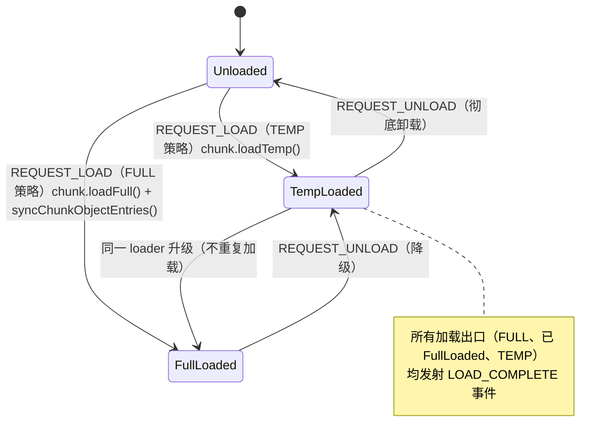

# 白板核心文档

## 概述

`BoardCore` 是白板在 Worker 线程中的纯数据实现，承载对象注册、区块加载、AOM、UndoTree、操作日志与 hit 提交、持久化协调等职责。不依赖 DOM、DevicesDAG、signalsEventBus。

UI 侧的 `Board` facade 通过 `BoardApiRpc` 与 Worker 侧的 `BoardCore` 通信。测试路径中可创建本地 `BoardCore` 实例。

## 运行边界

| 类             | 线程   | 职责                                           |
| -------------- | ------ | ---------------------------------------------- |
| `BoardCore`    | Worker | 对象与区块管理、AOM、UndoTree、持久化协调      |
| `Board`        | UI     | facade、输入分发、viewport 管理、Worker 初始化 |
| `BoardApiRpc`  | UI     | RPC 客户端，通过 postMessage 与 Worker 侧通信  |
| `ViewportCore` | Worker | 视口状态、chunk buffer、base/live 渲染         |

## 核心字段

| 名称                  | 描述                                                                                  |
| --------------------- | ------------------------------------------------------------------------------------- |
| `width` / `height`    | 区块尺寸（像素），用于 worldToChunkId 计算                                            |
| `rootPath`            | 白板文件根路径，`undefined` 时为内存模式                                              |
| `operationLog`        | 操作日志（hit 数据池），`OperationLog` 实例                                           |
| `undoTree`            | UndoTree 实例                                                                         |
| `hitCommitter`        | hit 提交器，分子操作的 commit 边界单点                                                |
| `trash`               | 已删除对象的回收站（objectId → 删除时刻的全量序列化与各区块层位边集）                 |
| `activeObjectManager` | AOM 实例，管理活动对象集合与动态层关系                                                |
| `chunkLoaded`         | `Map<chunkId, BoardChunkLoadedState>`，记录各区块的加载计数、loader 策略与状态槽（TEMP 元数据、FULL、AOM 写缓冲、空壳） |
| `objectLoaded`        | `Map<objectId, BoardObjectLoadedState>`，白板级对象实例注册表                         |
| `chunkLoadEventBus`   | 区块加载事件总线（REQUEST_LOAD / REQUEST_UNLOAD / LOAD_COMPLETE）                     |
| `activityEventBus`    | AOM 活动事件总线（ephemeral），本地 choose/unchoose/commit 手势事件即时广播，不经日志 |
| `rootChunkLoader`     | 根区块加载器，负责区块实例的创建、持有、释放                                          |
| `persistenceAdapter`  | 持久化适配器接口，内存模式使用默认实现，文件模式为 `createPersistenceAdapter`         |
| `aomRenderHooks`      | 注入式渲染钩子，替代 AOM 对 viewport/renderer 的直接依赖                              |
| `#objectCoverChunks`  | 集中式对象覆盖区块索引（objectId → Set&lt;chunkId&gt;），全 BoardCore 唯一权威副本    |
| `#objectTypes`        | 对象类型索引（objectId → type），部分驻留下无需实例即可回答对象清单                   |
| `#residencyManager`   | 区块驻留缓存（owner 部分驻留时由 daemon 注入），未设置时按需使用临时 loader           |
| `#removedObjectIds`   | 待删除对象 id 队列：真正离开白板的对象由 journaler 显式删除文件                       |

## 对象驻留与懒加载

部分驻留让 owner 不必把所有对象实例留在内存；对象被加载 **⟺** 其覆盖区块中至少一个被 FULL 持有。

- `restoreSession(session, { chunksTemp: true })`：只回填区块静态图、覆盖索引与对象类型，区块标记 TEMP，不注册对象实例；后续 FULL 请求经 `loadFull()` + `syncChunkObjectEntries()` 从 `objects/` 读回对象。GUI 持久化开板与 daemon owner 都走该模式。
- `setObjectIndexLoader(fn)` / `ensureObjectTypeIndex()`：区块元数据 `objectTypes` 已覆盖全部已知对象时直接完成；仍有缺失（旧板）才调用加载器扫描 `objects/` 回退。`getKnownObjectEntries()` 先列驻留对象，再补覆盖索引中的未驻留对象。
- `getPristineObjectJson(id)`：对象经区块加载路径从盘读入时的原始 JSON 指纹，供 journaler 首轮 flush 跳过未修改对象的重写。
- `getKnownObjectIds()` 与 `isObjectKnown()` 不随驱逐缩小；`isFullResidency()` 要求无驱逐标记且驻留对象数覆盖全部已知对象，懒加载/部分驻留端返回 false。该字段仅作诊断；物化摘要保留合法未驻留对象的逻辑状态，不再据此门控。`isObjectLegallyUnloaded(id)` 只按该对象覆盖区块判断是否没有 FULL 持有，供局部修复避免全对象扫描。
- `ensureObjectsResident(ids)` / `ensureChunksResident(ids)`：有驻留管理器时交给缓存，否则用临时 loader FullLoad 并返回 `destroy(300)` 的释放函数；`ensureChunkMetadata(ids)` 只加载 TEMP 元数据。
- `loadChunksIntoLoader(loader, chunks)`：让指定 loader 以 FULL 持有区块并等待加载完成，供驻留缓存复用。
- `getPinnedChunkIds()`：AOM 全部成员（活动对象、pickup 的非活动层成员、远程选择成员）覆盖区块的并集；`unloadChunkObjectEntries` 与 `#syncObjectEntryForChunk` 也不会移除任何仍在 AOM 中的对象。

区块缓存本身见 [residency-cache-document.md](./residency-cache-document.md)。

## 区块状态槽

`chunkLoaded` 的计数只表示当前有多少 loader 持有该区块，**counts 0 不等于内容为空**。同一个 Map 里有四类状态：

| `kind` | 判据 | 含义 |
| --- | --- | --- |
| `FULL` | `fullLoadedCount > 0`，或 `isLoad && !isTempLoad` | 对象实例已载入 |
| `TEMP` | `tempLoadedCount > 0`，或 `isLoad && isTempLoad` | 只回了层叠图/元数据，没有对象实例；开板恢复的元数据也属于这一态 |
| `WRITE_BUFFER` | `!isLoad` 且存在 `objectManager` | AOM 在未加载区块上写入的静态图层/写缓冲 |
| `EMPTY` | 其余 | 没有 loader、没有静态图的空壳 |

完全卸载时只有 `EMPTY` 状态槽会被回收；`WRITE_BUFFER` 仍可能被 journaler 调和写盘，不能删。调试查询 `chunkLoadState` 会输出 `kind`、`isLoad`、`isTempLoad`、`hasGraph`、`graphNodes` 与 `loaderCount`。

## 对象活性与显式删除

- `getKnownObjectIds()` 返回覆盖索引键、驻留对象 id 与已载区块静态图节点的并集；它不随对象驱逐而缩小，供 journaler 做驻留无关的活性判定。
- 真正移除对象（撤销新增、创建型分子中止等）调用 `markObjectRemoved(id)` 登记；移入 trash 不算真正移除。
- `journaler` 处理完显式删除后调用 `clearRemovedObjectIds(ids)`；删除失败时保留队列，下轮重试。

## Chunk 加载生命周期

BoardCore 通过事件总线驱动区块的加载与卸载：



加载策略由 `ChunkLoader` 的 `requesterId` 跟踪。同一 loader 从 TEMP 升级到 FULL 时不会重复加载。

### FULL vs TEMP

| 策略 | 加载内容                                                                 | 触发方                                                   |
| ---- | ------------------------------------------------------------------------ | -------------------------------------------------------- |
| TEMP | 层叠图（tierGraph）+ 覆盖索引（objectCoverIndex）+ 对象类型（objectTypes） | `pickup()` 遍历                                          |
| FULL | TEMP 内容 + `syncChunkObjectEntries()`（从磁盘加载对象实例）             | `apply()` 提交、`syncChunkBufferWithViewport()` 视口同步 |

## 对象覆盖索引

`objectCoverChunks`（objectId → 覆盖的区块 id 集合）集中在 `BoardCore.#objectCoverChunks` 统一管理。

```javascript
setObjectCoverChunks(objectId, chunkIds); // 写入
getObjectCoverChunks(objectId); // 读取
unsetObjectCoverChunks(objectId); // 删除
```

`ChunkObjectManager` 上的同名方法以可选链委托到 `BoardCore`：无 board 时写入为空操作，读取返回空集合。

## 持久化

`BoardCore` 自身不直接落盘：区块元数据与对象读写经 `persistenceAdapter`（内存模式为 `createDefaultPersistenceAdapter()` 空实现，文件模式为 `createPersistenceAdapter({ driver, rootId })`）；会话级落盘与恢复由 store 层承担（见[会话存储内核文档](../../store/docs/store-document.md)、[文件结构文档](../../../docs/file-structure.md)）：

- **分片落盘（布局 v2）**：日志分片、写权仲裁、元数据分片细则见会话存储内核文档。
- **会话恢复**：打开既有板时 `restoreSession({ chunkMetadataList, objects, trash }, { chunksTemp })` 先回填各区块层叠图与对象类型，并按各区块静态图重建覆盖索引（盘上 `objectCoverIndex` 仍为空；重建保证恢复后的对象归属与加载计数可算）。默认恢复的区块标记完整加载态并注册活动对象实例；`chunksTemp: true` 时区块只标记 TEMP、不注册对象，供 GUI 与 daemon owner 懒加载。最后恢复 trash 条目（含层位边，供跨会话撤销删除）。

内存模式下所有操作无副作用。

## 相关文档

- [board-document.md](../../../ui/components/orchestration/docs/board-document.md)（UI 侧 Board facade）
- [active-object-manager-document.md](./active-object-manager-document.md)
- [viewport-core-document.md](../../../renderers/canvas/docs/viewport-core-document.md)
- [tier-graph-document.md](./tier-graph-document.md)（层的存取与静态关系计算）
